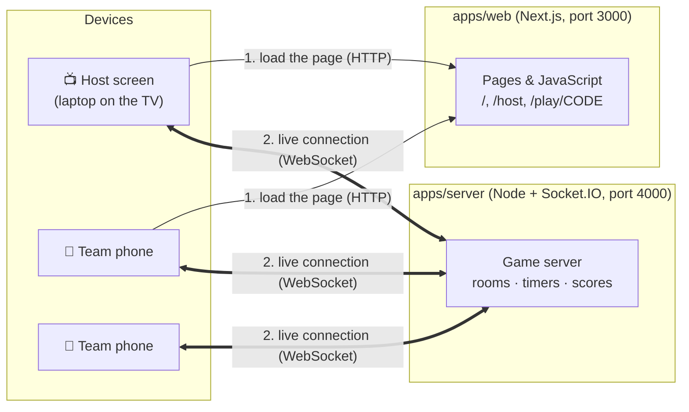

# How Pub Quiz works

A plain-English guide to the system: what each part does, how the parts talk
to each other, and why it's built this way. It's written so you can explain the
project confidently in an interview without having written every line.

---

## 1. The big picture

There are **two servers** with very different jobs:

| | Web app (`apps/web`) | Game server (`apps/server`) |
|---|---|---|
| Job | Hands out the pages and JavaScript | Runs the actual games |
| Talks over | HTTP: one request, one response, then done | WebSocket: a connection that stays open for the whole game |
| Remembers things? | No (**stateless**) | Yes: every room, team and score (**stateful**) |
| Built with | Next.js 16, React 19, Tailwind | Node.js, Socket.IO, zod |

And a third package, `packages/shared`, is the **contract** between them: the
TypeScript types for every message, plus the validation rules. Both sides
import it, so if one side changes a message's shape, the other side stops
compiling until it's updated.

### Why two servers instead of one?

Next.js is usually hosted on platforms like Vercel, which run code in short
bursts: a request comes in, a function runs, it shuts down. That's great for
web pages, but a pub quiz needs a **long-lived process** that keeps 50 phones
connected for an hour and runs a countdown timer. So the live game gets its own
small Node server. This split (stateless web tier, stateful real-time tier) is
how most real-time apps are built, from chat apps to multiplayer games.

---

## 2. Follow a tap: what happens when a team answers

Let's trace one tap on "B: Mars" from the phone to the TV.

1. **Phone UI.** `PlayerQuestion` calls `onAnswer(0, 1)` (question 0, option 1).
   → [`PlayerViews.tsx`](apps/web/src/components/player/PlayerViews.tsx)

2. **Optimistic update.** The phone shows "Locked in" *immediately*, before
   the server has replied, so it feels instant. If the server later says no
   (say, "Too late!"), the phone undoes it and shows an error.
   → `answer()` in [`PlayerScreen.tsx`](apps/web/src/components/player/PlayerScreen.tsx)

3. **Send over the WebSocket.** `socket.emitWithAck("player:answer", {questionIndex: 0, optionIndex: 1})`.
   "WithAck" means "and wait for the server to reply" (an *acknowledgement*).

4. **Server checks the message.** Anyone can open the browser console and send
   garbage, so the server checks the shape with **zod** first.
   → `answerPayloadSchema` in [`validation.ts`](packages/shared/src/validation.ts)

5. **Server checks *who* sent it.** The connection was linked to a team when it
   joined (`socket.data.playerId`), so a phone can only ever answer as itself.
   → `player:answer` handler in [`createGameServer.ts`](apps/server/src/createGameServer.ts)

6. **Game rules.** `Room.submitAnswer()` checks the question is still open, the
   option exists, and the team hasn't already answered. It records the answer
   with the **server's** clock time.
   → [`Room.ts`](apps/server/src/game/Room.ts)

7. **Everyone answered? Close early.** If every connected team has answered,
   the room closes the question, scores everyone and moves to `reveal`.

8. **Broadcast.** The room calls `onChange`, and the server pushes the new
   `room:state` to **every** screen in that room at once (Socket.IO "rooms").

9. **Screens redraw.** Each screen's `GameConnection` receives the state, and
   React re-renders. The TV highlights Mars; the phone shows "Correct! +841".
   → [`connection.ts`](apps/web/src/lib/connection.ts)

The key idea: **phones and the TV never change the game themselves.** They send
*requests*, and only the server decides what happens. Then everyone redraws
from the same state.

---

## 3. The ideas worth knowing

### Server-authoritative state
The `Room` on the server is the single source of truth. Screens are just
displays. This stops cheating (a phone can't award itself points) and stops
screens disagreeing with each other.

> *Interview version:* "The server is authoritative. Clients send intents, the
> server validates them against the game rules, and broadcasts the resulting
> state to everyone."

### Game rules are separate from networking
`Room.ts` knows nothing about WebSockets. It's a plain class with methods like
`start()` and `submitAnswer()`, and it calls `onChange` when something changes.
`createGameServer.ts` is the thin layer that turns network messages into those
method calls. Because of that split, the rules can be tested in milliseconds
without starting a server, using fake timers to jump forward in time.

### A typed contract
[`events.ts`](packages/shared/src/events.ts) lists every message both ways.
Socket.IO uses those types, so `socket.emit("player:anser")` (typo) is a
compile error, not a bug you find at the pub.

### Never trust the client
Every incoming message is validated with zod. Names are trimmed and limited to
24 characters. Room codes must be 4 consonants. Option numbers must be 0–3.
The same rules run in the browser for friendly error messages, but the
server's check is the one that matters.

### Secrets vs identities
Each team has a public `id` (everyone can see it, it's how scores are keyed)
and a secret `token` (only that phone knows it, it's how they prove who they
are when reconnecting). The host has a secret `hostToken` too. Tokens are never
included in the broadcast state; there's a test that checks exactly that.
Tokens are compared with `timingSafeEqual`, which takes the same time whether
the first character or the last one is wrong. That way an attacker can't guess
a token one character at a time by measuring response times.
→ [`security.ts`](apps/server/src/security.ts)

### Reconnection
Phones lock, Wi-Fi drops, people refresh. When a team joins, its token is saved
in `localStorage`. When the page reconnects (Socket.IO reconnects
automatically), it sends `player:resume` with that token and carries on as the
same team, even mid-question, and the server tells it what it had already
answered. The host screen does the same with `host:resume`, so refreshing the
TV doesn't end the game. The server also stops waiting for teams that have
disconnected, so one phone in a pocket can't stall the whole pub.

### Fair timing
- Points depend on speed (500 for a right answer, plus up to 500 for speed), and
  speed is measured by **when the server received the answer**, never by
  the phone's own clock, which could be wrong or faked.
- Answers arriving up to 0.5 s after the deadline still count (`ANSWER_GRACE_MS`),
  because the network takes time.
- Each phone's clock may be a few seconds off, so every state message includes
  `serverNow`. Screens work out the difference (`clockOffset`) and correct their
  countdowns, so the TV and every phone show the same number.

### Room codes with no vowels
Codes use `BCDFGHJKLMNPQRSTVWXZ`. With no vowels, a random code can't spell a word.
That's still 160,000 combinations, and `RoomManager` never hands out a code
that's in use.

### In-memory storage, on purpose (for now)
Rooms live in a JavaScript `Map` in the server's memory. That's fast and simple,
but it has two limits:
1. Restarting the server ends every game.
2. You can only run **one** copy of the server, because each copy would have
   its own separate rooms.

These are the next milestones' problems (see the roadmap). Knowing a design's
limits is as important as the design itself, and interviewers love asking about them.

---

## 4. Front-end patterns used

- **External store + `useSyncExternalStore`.** The WebSocket lives in a plain
  class (`GameConnection`), outside React. Components subscribe to it. A
  re-render can never accidentally open a second connection, and the socket
  logic doesn't depend on React at all.
  → [`connection.ts`](apps/web/src/lib/connection.ts), [`useGameConnection.ts`](apps/web/src/lib/useGameConnection.ts)
- **`useEffectEvent` (React 19.2+).** Lets the "on connect" callback always see
  the latest props without tearing down and reopening the connection.
- **Form actions with `useActionState` (React 19).** The team-name form gets
  its pending state and error result from React, with no manual `isLoading` flag.
  → `JoinForm` in [`PlayerViews.tsx`](apps/web/src/components/player/PlayerViews.tsx)
- **Cache Components + Suspense (Next.js 16).** `/play/[code]` serves a static
  shell instantly and renders the part that needs the code inside `<Suspense>`.
  → [`page.tsx`](apps/web/src/app/play/[code]/page.tsx)
- **Design tokens in CSS.** Colours and animations are defined once in
  [`globals.css`](apps/web/src/app/globals.css) and become Tailwind classes
  (`bg-brass`, `animate-pop`). Each answer has a colour **and** a letter, so
  colour-blind players aren't left guessing.

---

## 5. How it's tested

| Level | What | Tool | Where | Speed |
|---|---|---|---|---|
| Unit | Game rules: scoring, phases, timers, secrets never leaked | Vitest + fake timers | `apps/server/test/Room.test.ts` and `scoringAndCodes.test.ts` | ~70 ms |
| Integration | The real server over real WebSockets: join, play, reconnect, bad input | Vitest + socket.io-client | `apps/server/test/gameServer.integration.test.ts` | ~100 ms |
| End-to-end | A host and 3 phones play a full quiz in real browsers; a phone refreshes mid-game | Playwright | `apps/web/e2e/full-game.spec.ts` | ~6 s |

This is the classic **testing pyramid**: lots of fast, focused tests at the
bottom and a few slow, realistic ones at the top.

---

## 6. Decisions log

| Decision | Why | What we gave up |
|---|---|---|
| Separate game server instead of Next.js API routes | Needs long-lived connections and timers | One more thing to deploy |
| Socket.IO instead of raw `ws` | Rooms, acknowledgements, auto-reconnect and a Redis adapter for scaling, built in | A slightly bigger library; both ends must use Socket.IO |
| WebSocket-only transport (no HTTP long-polling fallback) | Faster, and multiple server copies won't need "sticky sessions" later | Very old or locked-down networks that block WebSockets |
| `npm` workspaces monorepo | One repo, one install, shared types without publishing a package | Nothing much at this size |
| zod for validation, in the shared package | One set of rules for the browser and the server | A dependency |
| Server measures answer time | Can't be faked | Players with slow connections lose a few points (the grace period softens this) |
| `localStorage` for rejoin tokens | Survives closing the tab and scanning the QR code again | Two tabs in the same browser share one team (test with separate browsers) |
| Rooms in memory | Simplest thing that works | Restarts end games; one server copy only (fixed in a later milestone) |

---

## 7. Roadmap

Each milestone teaches a back-end topic, lined up with your LinkedIn Learning
back-end collection.

| # | Milestone | You'll learn | Course |
|---|---|---|---|
| ✅ 1 | Live game: rooms, joining, questions, scoring, reconnecting | WebSockets, server state, validation, testing | *Node.js Essential Training*; *Node.js: Web Servers, Tests, and Deployment* |
| 2 | Quiz builder + saved results: hosts write their own quizzes; scores saved | PostgreSQL, schema design, migrations, a REST API | *PostgreSQL Essential Training*; *Designing RESTful APIs* |
| 3 | Go live on the internet | Docker, environment variables, hosting, HTTPS | *Learning Docker* |
| 4 | AI-written rounds (optional): "90s telly, 10 questions" → a checked round | Calling an LLM API, structured output, rate limits, spending caps | *AI for React Developers* |
| 5 | Scale out: run several game-server copies | Redis, pub/sub, the Socket.IO Redis adapter | *Redis Essential Training* |

---

## 8. Questions an interviewer might ask, and your answers

**"Why WebSockets and not polling?"**
Polling means every phone asks "anything new?" every second: lots of wasted
requests and up to a second of lag. A WebSocket stays open, so the server
pushes updates the instant they happen. For a timed quiz that matters.

**"How do you stop cheating?"**
The server is authoritative: answers are checked against the rules, timed by
the server's clock, and the correct answer isn't sent to phones until the
question closes. Each connection can only act as the team it joined as.

**"What happens if a phone loses signal?"**
Socket.IO reconnects automatically. The phone sends its secret token and
resumes as the same team, keeping its score and its answer to the current
question. The game doesn't wait for offline teams.

**"How would you scale this to 10,000 players?"**
Today it's one process with rooms in memory. To scale out, I'd run several
copies behind a load balancer and add Redis, both as shared storage for room
state and through the Socket.IO Redis adapter, so a broadcast from one server
copy reaches phones connected to the others. Because we use WebSocket-only
transport, we don't need sticky sessions.

**"Why is the game logic in a class with no networking?"**
Separation of concerns: the rules are pure and fast to test (fake timers let a
20-second countdown run in microseconds), and the network layer stays thin.
If we swapped Socket.IO for something else, the rules wouldn't change.

---

## Glossary

- **WebSocket:** a connection between browser and server that stays open, so either side can send messages at any time.
- **Socket.IO:** a library on top of WebSockets that adds rooms, acknowledgements and auto-reconnect.
- **Ack (acknowledgement):** the server's reply to a specific message, like a return receipt.
- **Stateless / stateful:** whether a server remembers anything between requests.
- **Server-authoritative:** the server decides what's true; clients only display it and send requests.
- **Schema validation:** checking incoming data has the expected shape before using it (we use zod).
- **Optimistic update:** showing the result of an action before the server confirms it, and undoing it if the server says no.
- **Monorepo / workspaces:** several packages in one repository that can import each other.
- **Clock offset:** how far a device's clock is from the server's; used to keep countdowns in sync.
