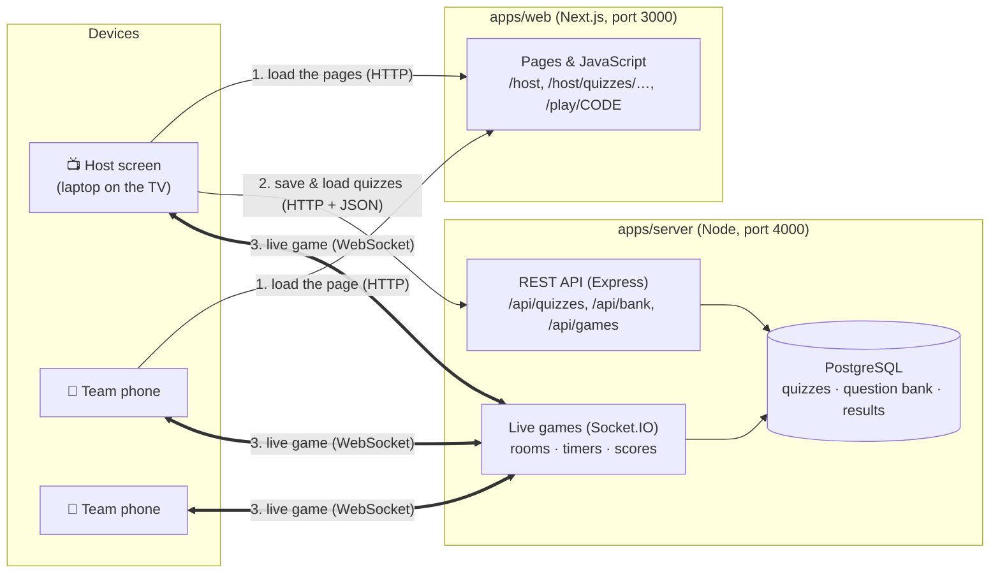

# How Pub Quiz works

A plain-English guide to the system: what each part does, how the parts talk
to each other, and why it's built this way. It's written so you can explain the
project confidently in an interview without having written every line.

---

## 1. The big picture



There are **two servers** with very different jobs:

| | Web app (`apps/web`) | Back-end server (`apps/server`) |
|---|---|---|
| Job | Hands out the pages and JavaScript | Stores quizzes and results (REST API) and runs live games (WebSockets) |
| Talks over | HTTP | HTTP for the API; WebSocket for games |
| Remembers things? | No (**stateless**) | Yes: quizzes and results in **PostgreSQL**; live games in memory |
| Built with | Next.js 16, React 19, Tailwind, TanStack Query | Node.js, Express 5, Socket.IO, Drizzle ORM, PostgreSQL, zod |

A third package, `packages/shared`, is the **contract** between them: the
TypeScript types for every message and API response, plus the validation
rules. Both sides import it, so if one side changes a shape, the other side
stops compiling until it's updated.

### Why two servers instead of one?

Next.js is usually hosted on platforms like Vercel, which run code in short
bursts: a request comes in, a function runs, it shuts down. That's great for
web pages, but a pub quiz needs a **long-lived process** that keeps 50 phones
connected for an hour and runs a countdown timer. So the back-end is its own
Node server. The REST API lives there too, so a single service owns the
database. This split (stateless web tier, stateful back-end) is how most
real-time apps are built.

### One process, two ways in

The back-end is one Node process listening on one port. Express handles normal
HTTP requests (`/api/...`), and Socket.IO handles WebSocket connections on the
same port. They share the database connection.
→ [`createGameServer.ts`](apps/server/src/createGameServer.ts), [`api/app.ts`](apps/server/src/api/app.ts)

---

## 2. Follow a tap: what happens when a team answers

Let's trace one tap on "B: Mars" from the phone to the TV.

1. **Phone UI.** `PlayerQuestion` calls `onAnswer(0, 1)` (question 0, option 1).
   → [`PlayerViews.tsx`](apps/web/src/components/player/PlayerViews.tsx)

2. **Optimistic update.** The phone shows "Locked in" *immediately*, before
   the server has replied, so it feels instant. If the server later says no
   (say, "Too late!"), the phone undoes it and shows an error.
   → `answer()` in [`PlayerScreen.tsx`](apps/web/src/components/player/PlayerScreen.tsx)

3. **Send over the WebSocket.** `socket.emitWithAck("player:answer", {questionIndex: 0, optionIndex: 1})`.
   "WithAck" means "and wait for the server to reply" (an *acknowledgement*).

4. **Server checks the message.** Anyone can open the browser console and send
   garbage, so the server checks the shape with **zod** first.
   → `answerPayloadSchema` in [`validation.ts`](packages/shared/src/validation.ts)

5. **Server checks *who* sent it.** The connection was linked to a team when it
   joined (`socket.data.playerId`), so a phone can only ever answer as itself.
   → `player:answer` handler in [`createGameServer.ts`](apps/server/src/createGameServer.ts)

6. **Game rules.** `Room.submitAnswer()` checks the question is still open, the
   option exists, and the team hasn't already answered. It records the answer
   with the **server's** clock time.
   → [`Room.ts`](apps/server/src/game/Room.ts)

7. **Everyone answered? Close early.** If every connected team has answered,
   the room closes the question, scores everyone and moves to `reveal`.

8. **Broadcast.** The room calls `onChange`, and the server pushes the new
   `room:state` to **every** screen in that room at once (Socket.IO "rooms").

9. **Screens redraw.** Each screen's `GameConnection` receives the state, and
   React re-renders. The TV highlights Mars; the phone shows "Correct! +841".
   → [`connection.ts`](apps/web/src/lib/connection.ts)

10. **Game over? Save it.** When the last question's scores have been shown,
    the room's phase becomes `finished` and the server saves every team's
    result to the database for the host's "Past games" list.

The key idea: **phones and the TV never change the game themselves.** They send
*requests*, and only the server decides what happens. Then everyone redraws
from the same state.

---

## 3. Follow a save: what happens when a host saves a quiz

1. **Check in the browser first.** As the host types, the quiz builder runs the
   draft through `quizInputSchema`, the same zod rules the server uses, and
   marks problems in red next to the right field ("Mark the correct answer").
   → [`QuizEditor.tsx`](apps/web/src/components/dashboard/QuizEditor.tsx), [`quiz.ts`](packages/shared/src/quiz.ts)

2. **Send it.** TanStack Query's `useMutation` calls `api.updateQuiz(id, quiz)`,
   which sends `PUT /api/quizzes/:id` with the quiz as JSON and the host's key
   in the header: `Authorization: Bearer pqh_…`.
   → [`api.ts`](apps/web/src/lib/api.ts)

3. **Who's asking?** Express runs the `requireHost` middleware: it hashes the
   key and looks it up. No match means `401 Unauthorized`.
   → [`auth.ts`](apps/server/src/api/auth.ts)

4. **Check again on the server.** The route parses the body with the same zod
   schema. A bad quiz gets `400 Bad Request` with a list of exactly what's
   wrong, which the builder shows next to the right fields.
   → [`routes.ts`](apps/server/src/api/routes.ts)

5. **Save it, all or nothing.** The repository runs a **transaction**: update
   the quiz's title, delete its old questions, insert the new ones. If anything
   fails halfway, the database rolls everything back, so there's never half a quiz.
   The update only matches rows where `host_id` is this host's, so nobody can
   overwrite someone else's quiz.
   → [`repositories/quizzes.ts`](apps/server/src/repositories/quizzes.ts)

6. **Update the screen.** The server replies with the saved quiz. TanStack Query
   puts it in its cache and marks the dashboard's quiz list as stale, so the
   list refetches next time it's shown.

---

## 4. The database

### What's stored

```
hosts ──< quizzes ──< quiz_questions
  │          │
  └────< games >───< game_teams            bank_questions (stands alone)
```

"──<" means one-to-many: one host has many quizzes; one quiz has many questions.

| Table | Holds |
|---|---|
| `hosts` | One row per host identity, storing a **hash** of their key, never the key itself |
| `quizzes` / `quiz_questions` | Each host's quizzes, with questions in order (`position`) |
| `bank_questions` | The shared question bank that quick quizzes draw from |
| `games` / `game_teams` | Finished games and every team's final score and rank |

The schema is written in TypeScript ([`schema.ts`](apps/server/src/db/schema.ts)), and
**migrations** (the SQL that creates and changes tables, in [`/drizzle`](apps/server/drizzle))
are generated from it with `npm run db:generate`. The server applies any new
migrations when it starts.

### Things the database enforces itself

Validation in code can have bugs, so the database has its own rules:
- **Foreign keys:** a question must belong to a real quiz. Delete a quiz and its
  questions go too (`ON DELETE CASCADE`). Delete a quiz that has been played and
  the results stay, with the link cleared (`ON DELETE SET NULL`); that's why
  each game also keeps a copy of the quiz title.
- **Check constraints:** 2–4 answers, and the correct answer must be one of them.
  There's a test that bypasses all our code to prove the database refuses a bad row.
- **Unique constraints:** two questions can't share a position in a quiz, and the
  bank can't hold the same question twice (after simplifying the text, so
  "What's the capital of France?" and "What is the capital of France" count as the same).
- **Indexes** on `host_id` and `category`, so "this host's quizzes" stays fast as data grows.

### PGlite now, a Postgres server later

PGlite is real PostgreSQL compiled to run *inside* Node: no install, no separate
service, and every test gets a fresh in-memory database in milliseconds. Data is
saved in `apps/server/.data/`. In milestone 3, production moves to a standalone
Postgres server (in Docker). The schema, migrations and queries don't change,
only [`db/client.ts`](apps/server/src/db/client.ts) does.

To look at the data, stop the server and run `npm run db:studio -w @pub-quiz/server`.

### Repositories

Only the files in [`repositories/`](apps/server/src/repositories) talk to the
database. Routes and the game server call functions like `getQuiz(db, id, hostId)`
and never build queries themselves. That keeps SQL in one place and makes the
data layer easy to test on its own.

---

## 5. The REST API

| Method & path | Does | Success |
|---|---|---|
| `POST /api/hosts` | Create a host identity, returning its secret key | 201 |
| `GET /api/quizzes` | List my quizzes | 200 |
| `POST /api/quizzes` | Create a quiz | 201 |
| `POST /api/quizzes/from-bank` | Create a quick quiz from random bank questions | 201 |
| `GET /api/quizzes/:id` | One quiz with its questions | 200 |
| `PUT /api/quizzes/:id` | Replace a quiz with a new version | 200 |
| `DELETE /api/quizzes/:id` | Delete a quiz | 204 |
| `GET /api/bank/categories` | Bank categories and counts | 200 |
| `GET /api/bank/questions?category=&difficulty=&search=&limit=&offset=` | Search the bank, a page at a time | 200 |
| `GET /api/games` | My finished games | 200 |
| `GET /api/games/:id` | One game's full results | 200 |

The REST conventions it follows:
- **URLs are nouns, methods are verbs.** `DELETE /api/quizzes/123`, not `POST /api/deleteQuiz`.
- **Status codes mean something:** 201 Created, 204 No Content, 400 your request
  is invalid, 401 we don't know who you are, 404 not found, 429 slow down, 500 our fault.
- **One error shape everywhere:** `{ "error": "…", "issues": [{ "path": "questions.2.text", "message": "…" }] }`,
  produced by a single error handler, which also makes sure stack traces and SQL never leak out.
  → [`errors.ts`](apps/server/src/api/errors.ts)
- **Someone else's quiz is a 404, not a 403.** Saying "forbidden" would confirm it exists.
- **Rate limiting** on `POST /api/hosts`, so a script can't create millions of hosts.
- **Express 5** sends errors from `async` handlers to the error handler
  automatically. Express 4 needed a `try/catch` in every route.

### Host identity without passwords (for now)

There are no accounts yet. The first time someone opens the dashboard, the
browser asks for a host key (`POST /api/hosts`) and keeps it in `localStorage`.
Every API request sends it as `Authorization: Bearer pqh_…`, and the host
screen sends it in the WebSocket handshake to prove it may play those quizzes.
- The server stores only a **SHA-256 hash** of each key. A stolen database
  contains no usable keys, the same idea as storing password hashes.
- Keys start with `pqh_` so a leaked one is easy to spot (GitHub's secret
  scanning works the same way for real API keys).
- The trade-off: clearing browser data loses your quizzes. Proper accounts
  (sign-in with email or Google) are a natural later milestone, and the
  `hosts` table is where they'd attach.

---

## 6. The question bank

- **Starter bank:** 70 questions written and checked by hand, across 8 categories,
  in [`data/starter-bank.json`](apps/server/data/starter-bank.json). Always present,
  so quick quizzes work out of the box at zero cost.
- **Big bank (optional):** [`scripts/generate-question-bank.ts`](apps/server/scripts/generate-question-bank.ts)
  uses Claude to write around 2,000 more across 12 categories, **once**. The result
  is saved to `data/question-bank.json` and committed, so nobody ever pays to
  generate it again. The server loads both files into the database on start-up,
  and loading is safe to repeat: duplicates are skipped (`ON CONFLICT DO NOTHING`).

How the generator keeps quality up:
1. **Write.** Each request asks for 35 questions in one category, difficulty and
   theme, with strict rules: one clearly right answer, no facts that go out of
   date, British spelling. It uses **structured outputs**, so the reply is
   guaranteed to be JSON in our schema.
2. **Check, blind.** A second pass shows each question to Claude *without* the
   marked answer and asks it to answer and flag anything ambiguous. Only
   questions where both passes agree, and nothing was flagged, are kept.
   This "LLM as a judge" step catches most wrong answers.
3. **Tidy.** Removes duplicates (including against the starter bank), puts numeric
   answers in order, and shuffles the rest so the right answer isn't always B.

Both passes use the **Message Batches API**: requests run in the background at
half price. The estimated cost for the whole bank is about $5.50–$13 with
Claude Opus 5.5, $2.80–$6.50 with Sonnet 5.5, or under $0.35 with Haiku 5.5.
`npm run bank:generate -w @pub-quiz/server` prints the plan and estimate for free,
and only spends money when run with `--yes`.

---

## 7. The ideas worth knowing

### Server-authoritative state
The `Room` on the server is the single source of truth. Screens are just
displays. This stops cheating (a phone can't award itself points) and stops
screens disagreeing with each other.

> *Interview version:* "The server is authoritative. Clients send intents, the
> server validates them against the game rules, and broadcasts the resulting
> state to everyone."

### Game rules are separate from networking and storage
`Room.ts` knows nothing about WebSockets or databases. It's a plain class with
methods like `start()` and `submitAnswer()`, and it calls `onChange` when
something changes. `createGameServer.ts` is the thin layer that turns network
messages into those method calls and saves results when a game finishes.
Because of that split, the rules can be tested in milliseconds without
starting a server, using fake timers to jump forward in time.

### A typed contract
[`events.ts`](packages/shared/src/events.ts) lists every WebSocket message both ways,
and [`quiz.ts`](packages/shared/src/quiz.ts) every API response shape. A typo like
`socket.emit("player:anser")` is a compile error, not a bug you find at the pub.

### Never trust the client
Every incoming message and request body is validated with zod. Names are
trimmed and limited. Room codes must be 4 letters from the allowed set. Option
numbers must be 0–3. The same rules run in the browser for friendly error
messages, but the server's check is the one that matters.

### Secrets vs identities
Each team has a public `id` (everyone can see it, it's how scores are keyed)
and a secret `token` (only that phone knows it, it's how they prove who they
are when reconnecting). The host's room has a secret `hostToken`, and the host
has a secret API key. Secrets are never included in the broadcast state, and
there's a test that checks exactly that. Tokens are compared with
`timingSafeEqual`, which takes the same time whether the first character or the
last one is wrong, so an attacker can't guess a token one character at a time
by measuring response times. Host keys are looked up by their hash instead.
→ [`security.ts`](apps/server/src/security.ts), [`repositories/hosts.ts`](apps/server/src/repositories/hosts.ts)

### Reconnection
Phones lock, Wi-Fi drops, people refresh. When a team joins, its token is saved
in `localStorage`. When the page reconnects (Socket.IO reconnects
automatically), it sends `player:resume` with that token and carries on as the
same team, even mid-question, and the server tells it what it had already
answered. The host screen does the same with `host:resume`, so refreshing the
TV doesn't end the game. The server also stops waiting for teams that have
disconnected, so one phone in a pocket can't stall the whole pub.

### Fair timing
- Points depend on speed (500 for a right answer, plus up to 500 for speed), and
  speed is measured by **when the server received the answer**, never by
  the phone's own clock, which could be wrong or faked.
- Answers arriving up to 0.5 s after the deadline still count (`ANSWER_GRACE_MS`),
  because the network takes time.
- Each phone's clock may be a few seconds off, so every state message includes
  `serverNow`. Screens work out the difference (`clockOffset`) and correct their
  countdowns, so the TV and every phone show the same number.

### Room codes people can read across a pub
Codes use `BCDFGHJKLMNPRSTVWXZ`: no vowels, so a random code can't spell a word,
which also rules out I and O (easily confused with 1 and 0). **Q was removed
after testing**, because in the TV's display font it looked like an O. That still
leaves 130,321 combinations, and `RoomManager` never hands out a code that's in use.

### What's in memory, and what's in the database
Quizzes, the question bank and results are in PostgreSQL and survive restarts.
**Live games** are still in a JavaScript `Map`: fast and simple, but
1. restarting the server ends any game in progress, and
2. you can only run **one** copy of the server, because each copy would have its own separate rooms.

Milestone 5 fixes both with Redis. Knowing a design's limits is as important
as the design itself, and interviewers love asking about them.

---

## 8. Front-end patterns used

- **TanStack Query for server data.** `useQuery` fetches and caches lists like
  "my quizzes" under keys ([`queryKeys`](apps/web/src/lib/api.ts)), with loading and
  error states for free. `useMutation` saves changes, then *invalidates* the right
  keys so stale lists refetch. Nothing is copied into local state by hand.
- **One API client.** Every request goes through `apiFetch`, which adds the host
  key and turns error responses into a typed `ApiError`.
  → [`api.ts`](apps/web/src/lib/api.ts)
- **The same validation as the server, live.** The quiz builder runs the shared
  zod schema on every change and maps each problem to its field by path
  (`questions.2.options.1`). If the server still rejects something, its
  `issues` list is mapped onto the same fields.
- **External store + `useSyncExternalStore`.** The WebSocket lives in a plain
  class (`GameConnection`), outside React. Components subscribe to it, so a
  re-render can never accidentally open a second connection.
  → [`connection.ts`](apps/web/src/lib/connection.ts), [`useGameConnection.ts`](apps/web/src/lib/useGameConnection.ts)
- **`useEffectEvent` (React 19.2+).** Lets the "on connect" callback always see
  the latest props without tearing down and reopening the connection.
- **Form actions with `useActionState` (React 19).** The team-name form gets
  its pending state and error result from React, with no manual `isLoading` flag.
- **The native `<dialog>` element** for the question-bank picker: the browser
  handles focus trapping, the Escape key and the backdrop, accessibly.
- **Cache Components + Suspense (Next.js 16).** Pages with an id in the URL
  serve a static shell instantly and render the part that needs the id inside `<Suspense>`.
- **Design tokens in CSS.** Colours and animations are defined once in
  [`globals.css`](apps/web/src/app/globals.css) and become Tailwind classes
  (`bg-brass`, `animate-pop`). Each answer has a colour **and** a letter, so
  colour-blind players aren't left guessing.

---

## 9. How it's tested

| Level | What | Tool | Where |
|---|---|---|---|
| Unit | Game rules: scoring, phases, timers, secrets never leaked | Vitest + fake timers | `apps/server/test/Room.test.ts`, `scoringAndCodes.test.ts` |
| Data | Repositories against a real in-memory Postgres: hashing, de-duplication, database rules, results | Vitest + PGlite | `apps/server/test/repositories.test.ts` |
| API | Every endpoint over HTTP: CRUD, privacy between hosts, validation errors, bad JSON | Vitest + supertest | `apps/server/test/api.test.ts` |
| Integration | The real server over real WebSockets: join, play, reconnect, host keys, saving results | Vitest + socket.io-client | `apps/server/test/gameServer.integration.test.ts` |
| End-to-end | Real browsers: a full 3-team game; a phone refreshing mid-game; building a quiz, playing it and finding the results | Playwright | `apps/web/e2e/` |

This is the classic **testing pyramid**: lots of fast, focused tests at the
bottom and a few slow, realistic ones at the top. The server suite (52 tests)
runs in about 3 seconds.

---

## 10. Decisions log

| Decision | Why | What we gave up |
|---|---|---|
| Separate back-end server instead of Next.js API routes | Needs long-lived connections and timers; one service owns the database | One more thing to deploy |
| Socket.IO instead of raw `ws` | Rooms, acknowledgements, auto-reconnect and a Redis adapter for scaling, built in | A slightly bigger library; both ends must use Socket.IO |
| WebSocket-only transport | Faster, and multiple server copies won't need "sticky sessions" later | Very old or locked-down networks that block WebSockets |
| `npm` workspaces monorepo | One repo, one install, shared types without publishing a package | Nothing much at this size |
| zod for validation, in the shared package | One set of rules for the browser and the server | A dependency |
| PostgreSQL (relational) rather than a document database | The data is naturally relational (hosts → quizzes → questions; games → teams); constraints and transactions protect it | Schema changes need migrations |
| PGlite for now | Real Postgres with nothing to install; instant throwaway databases for tests | Only one process can open the data at a time; moves to a Postgres server in milestone 3 |
| Drizzle ORM rather than Prisma | Queries look like SQL (good for learning SQL), fully typed, no code-generation step, works with PGlite | Smaller ecosystem than Prisma |
| Express 5 for the REST API | The most widely known Node framework; v5 handles async errors | Less built-in validation than Fastify or Hono (zod covers it) |
| Questions in their own table, not a JSON blob | Proper SQL practice: ordering, constraints and per-question queries | A join when loading a quiz |
| Saving a quiz replaces all its questions | Far simpler than working out which questions moved or changed; quizzes are small; a transaction keeps it safe | Question ids change on every save (nothing depends on them) |
| Host keys instead of accounts | No passwords to handle; you can host straight away | Clearing browser data loses access; proper sign-in can come later |
| Store a hash of each host key | A stolen database contains no usable keys | Keys can't be shown again (they don't need to be) |
| Question bank as committed JSON, loaded at start-up | Generated once, reviewable in git, free for everyone after | The JSON file is large-ish (about 400 KB) |
| Batch API + blind second check for AI questions | Half price; a second, independent pass catches wrong answers | Takes up to an hour instead of minutes |
| Server measures answer time | Can't be faked | Players with slow connections lose a few points (the grace period softens this) |
| `localStorage` for rejoin tokens and host keys | Survives closing the tab and scanning the QR code again | Two tabs in the same browser share one identity (test with separate browsers) |
| Live rooms in memory | Simplest thing that works | Restarts end live games; one server copy only (fixed in milestone 5) |

---

## 11. Roadmap

Each milestone teaches a back-end topic, lined up with your LinkedIn Learning
back-end collection.

| # | Milestone | You'll learn | Course |
|---|---|---|---|
| ✅ 1 | Live game: rooms, joining, questions, scoring, reconnecting | WebSockets, server state, validation, testing | *Node.js Essential Training*; *Node.js: Web Servers, Tests, and Deployment* |
| ✅ 2 | Quiz builder, question bank and saved results | PostgreSQL, schema design, migrations, transactions, a REST API, API auth | *PostgreSQL Essential Training*; *Designing RESTful APIs* |
| 3 | Go live on the internet | Docker, a real Postgres server, environment variables, hosting, HTTPS, CI | *Learning Docker* |
| 4 | AI-written rounds on demand (optional): "90s telly, 10 questions" | Calling an LLM from a server, streaming, rate limits, spending caps | *AI for React Developers* |
| 5 | Scale out: run several back-end copies | Redis, pub/sub, the Socket.IO Redis adapter | *Redis Essential Training* |

---

## 12. Questions an interviewer might ask, and your answers

**"Why WebSockets and not polling?"**
Polling means every phone asks "anything new?" every second: lots of wasted
requests and up to a second of lag. A WebSocket stays open, so the server
pushes updates the instant they happen. For a timed quiz that matters.

**"How do you stop cheating?"**
The server is authoritative: answers are checked against the rules, timed by
the server's clock, and the correct answer isn't sent to phones until the
question closes. Each connection can only act as the team it joined as.

**"What happens if a phone loses signal?"**
Socket.IO reconnects automatically. The phone sends its secret token and
resumes as the same team, keeping its score and its answer to the current
question. The game doesn't wait for offline teams.

**"How do you make sure one host can't see another's quizzes?"**
Every query is scoped by `host_id`, which comes from the authenticated key,
never from the request body. Someone else's quiz returns 404, so we don't even
confirm it exists. There are API tests for exactly this.

**"Why store a hash of the key instead of the key?"**
Same reason you hash passwords: if the database leaked, the hashes are useless
for logging in. We use SHA-256 rather than bcrypt because the keys are long
random strings, not guessable passwords, so there's nothing to brute-force.

**"What if saving a quiz fails halfway through?"**
It runs in a transaction: update the quiz, delete the old questions, insert
the new ones. Either all of that happens or none of it does.

**"Why SQL and not MongoDB?"**
The data is relational (hosts own quizzes, quizzes own questions, games own
results), and I wanted the database to enforce the rules with foreign keys,
check constraints and transactions, not just the application code.

**"How did you make sure the AI-generated questions were right?"**
A two-pass pipeline: one pass writes questions against a strict brief and a JSON
schema, then a separate, blind pass answers each question without seeing the
marked answer. Only questions where both agree, with nothing flagged, are kept.
It ran through the Batch API at half price, the result is committed to the
repo, and it cost a few dollars once.

**"How would you scale this to 10,000 players?"**
Today live games are one process with rooms in memory. To scale out, I'd run
several copies behind a load balancer and add Redis, both as shared storage for
room state and through the Socket.IO Redis adapter, so a broadcast from one
server copy reaches phones connected to the others. Because we use
WebSocket-only transport, we don't need sticky sessions. The database would
move to a managed Postgres with connection pooling.

**"Why is the game logic in a class with no networking?"**
Separation of concerns: the rules are pure and fast to test (fake timers let a
20-second countdown run in microseconds), and the network layer stays thin.
If we swapped Socket.IO for something else, the rules wouldn't change.

---

## Glossary

- **WebSocket:** a connection between browser and server that stays open, so either side can send messages at any time.
- **Socket.IO:** a library on top of WebSockets that adds rooms, acknowledgements and auto-reconnect.
- **Ack (acknowledgement):** the server's reply to a specific message, like a return receipt.
- **REST API:** a set of URLs (resources) that you act on with HTTP methods (GET, POST, PUT, DELETE), usually sending JSON.
- **Middleware:** code that runs before a route handler, e.g. to check who's asking.
- **Stateless / stateful:** whether a server remembers anything between requests.
- **Server-authoritative:** the server decides what's true; clients only display it and send requests.
- **Schema validation:** checking incoming data has the expected shape before using it (we use zod).
- **Migration:** a script that changes the database's structure (adds a table, a column…), applied in order and tracked.
- **Transaction:** a group of database changes that succeed or fail together.
- **Foreign key:** a column that must point at a real row in another table.
- **Index:** a lookup structure that makes searching a column fast.
- **ORM / query builder:** a library for writing database queries in your programming language (we use Drizzle).
- **Hash:** a one-way fingerprint of some data: easy to compute, impossible to reverse.
- **Rate limit:** a cap on how many requests someone can make in a time window.
- **Optimistic update:** showing the result of an action before the server confirms it, and undoing it if the server says no.
- **Batch API:** sending many AI requests to be processed in the background, cheaper than one at a time.
- **Monorepo / workspaces:** several packages in one repository that can import each other.
- **Clock offset:** how far a device's clock is from the server's; used to keep countdowns in sync.
